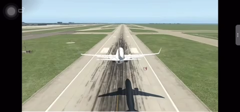
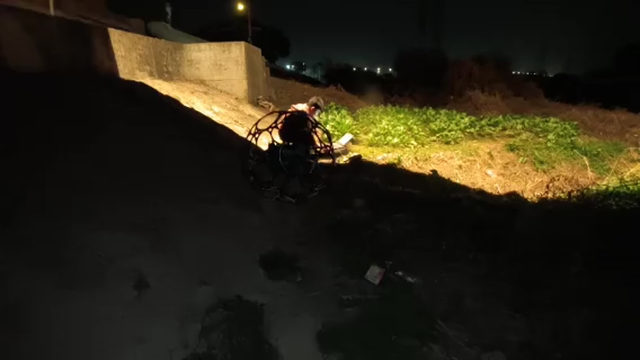
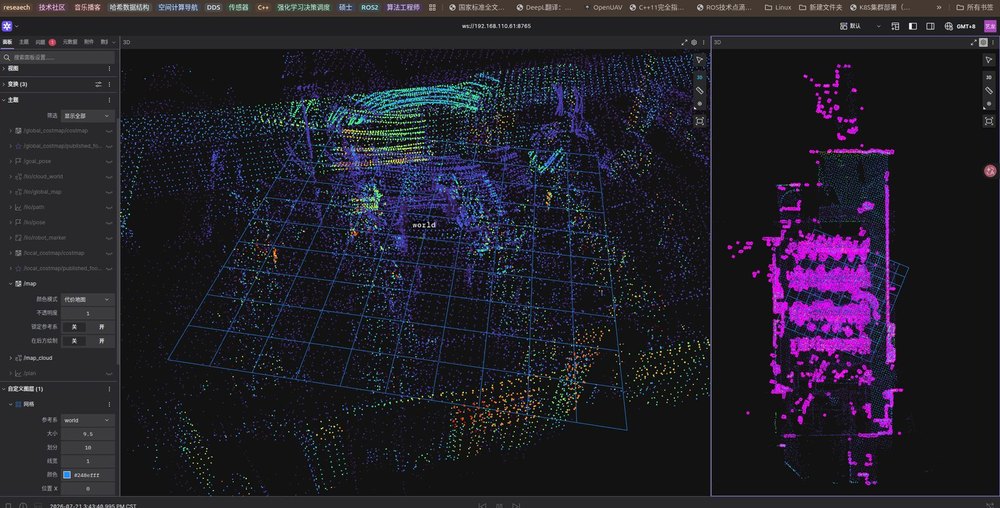
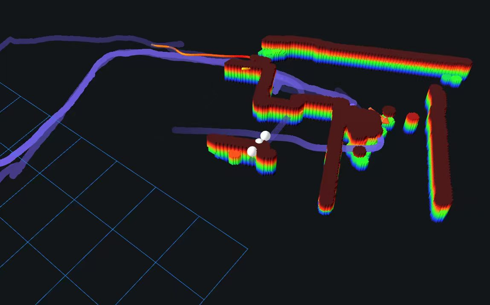
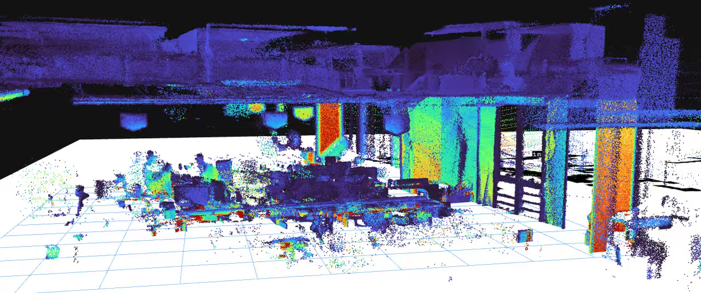
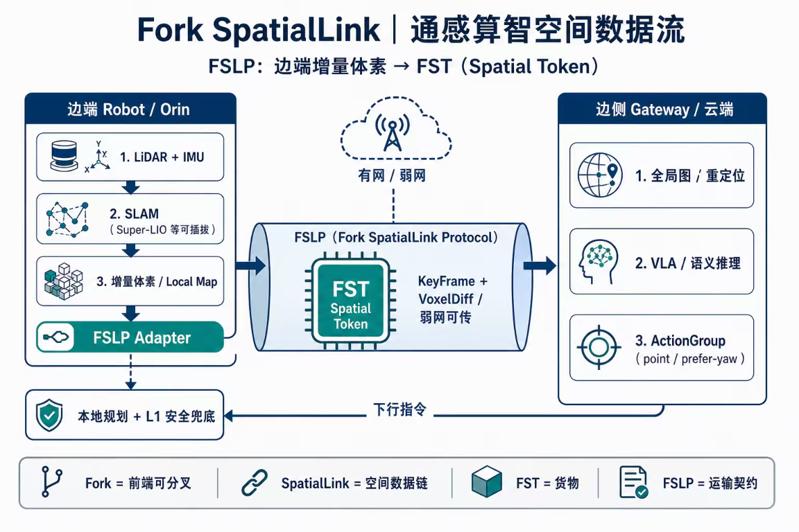

# Hi, I'm Xinyu Zeng 👋

### Robotics & Spatial Intelligence · Reliable Autonomy · Multi-Agent Coordination · Sociotechnical Systems

[中文](./README.md) | **English**

## About Me

> **From Engineering Practice to Systems Thinking**
>
> Coming from communications engineering, I have been developing autonomous systems for unmanned systems and robots, covering autonomous navigation, embedded systems, and middleware in GPS-denied, weak-network, and dynamic environments.
>
> As my practice extended from low-level state estimation and system implementation to the interaction between spatial state and upstream agents, my focus shifted from individual algorithms to the organizational mechanisms of intelligent systems: **how to understand and manage spatial state, organize intelligent behavior, and enable different agents to coordinate reliably under uncertainty.**

---

## Selected Engineering Work

Three representative work stages; commercial work, production work, and personal open-source rewrites are stated separately.

### Case A · Autonomous robot systems in constrained environments

- **Background**: UAV and multi-robot navigation in GPS-denied, weak-network, industrial-inspection environments.
- **Role**: Autonomous navigation R&D, state-machine task orchestration, multi-robot coordination, embedded deployment and integration.
- **Approach**: Built a GPS-denied UAV navigation task-execution middleware product on message-oriented middleware, on geometric SLAM and classical motion control; participated in military aircraft navigation module R&D.
- **Outcome**: Delivered across AGV, GPS-denied quadrotor, quadrupedal and bipedal platforms in weak-network, strong-interference, mixed indoor-outdoor environments.

**▶ Demo (click cover to play)**

| Military aircraft navigation module (sanitized simulator showcase) | GPS-denied UAV autonomous inspection in darkness |
| --- | --- |
|  |  |

### Case B · Legged robot autonomous navigation in dynamic environments

- **Background**: Long-duration, cross-floor goal navigation for quadrupedal robots in dynamic, unstructured environments.
- **Role**: Edge-cloud resource allocation, self-developed navigation middleware, scenario adaptation of key algorithms.
- **Approach**: Built edge-cloud navigation middleware, unifying localization state, task contracts, planning interfaces, and fault-recovery semantics.
- **Outcome**: Cross-floor loop passed cloud simulation 11/11; real-robot online mapping and planning running (see [quadruped-crossfloor-nav-ws](https://github.com/zxinyu-robot/quadruped-crossfloor-nav-ws)).

**▶ Demo**

| Edge-device map stitching | Online real-time voxel | Online real-time local point cloud |
| --- | --- | --- |
|  |  |  |

### Case C · Spatial state and intelligent system interaction

- **Background**: How robot spatial state can be reliably consumed by upstream agents and world models.
- **Role**: Engineering the three-space framework; designing world-state data distribution.
- **Approach**: Built a data-distribution middleware for the world-space state produced by legged robots, enabling asynchronous state-task navigation behavior interaction with upstream world models.
- **Outcome**: Publicly rewritten into buildable, testable cores — state contracts, localization recovery, terrain contracts, weak-network coordination, shared-memory fusion, read-only diagnostics.

**▶ Demo (spatial state interaction / data flow)**

| State-contract & task interaction sequence | Fork SpatialLink data flow |
| --- | --- |
|  |  |

<small>Click to enlarge: left — state-contract and task interaction sequence; right — Fork SpatialLink (FSLP) edge-to-edge spatial data flow.</small>

---

## Current Work

Unified direction: **autonomous intelligent systems in real environments and how they are organized**.

### Shared foundation · spatial state and contracts

- **[ForkSpatial-Runtime-Engine](https://github.com/zxinyu-robot/ForkSpatial-Runtime-Engine)** — state contracts, execution leases and spatial-state runtime.
- **[spatial-map-foundation](https://github.com/zxinyu-robot/spatial-map-foundation)** — map tiles, spatial anchoring and versioned state transactions.

### 1 · Single-agent intelligence

- **[quadruped-crossfloor-nav-ws](https://github.com/zxinyu-robot/quadruped-crossfloor-nav-ws)** — Go2 quadruped cross-floor navigation with a real-robot loop.
- **[legged-navigation-runtime](https://github.com/zxinyu-robot/legged-navigation-runtime)** — legged navigation runtime, failure recovery and diagnostics.
- **[SlamDoctor-Runtime](https://github.com/zxinyu-robot/SlamDoctor-Runtime)** — offline diagnostics for robot autonomy logs.

### 2 · Collective intelligence

- **[swarm-adapter-foundation](https://github.com/zxinyu-robot/swarm-adapter-foundation)** — multi-robot state, map and directive contracts, weak-network coordination and submap fusion.

### 3 · Sociotechnical systems

No dedicated repository yet. Related mechanisms are distributed across state contracts, failure recovery, human-takeover learning and runtime execution semantics.

For the detailed systems perspective, research agenda and engineering principles, see:

- [Systems Perspective](docs/systems-perspective.md)
- [Research Agenda](docs/research-agenda.md)
- [Engineering Philosophy](docs/engineering-philosophy.md)

---

## Public Collaboration

All `Current Work` projects are open to different levels of participation.

Priority entry points:

- **[SlamDoctor-Runtime](https://github.com/zxinyu-robot/SlamDoctor-Runtime)** — offline diagnostics, ROS 2 / rosbag2 / MCAP adapters and fault cases.
- **[legged-navigation-runtime](https://github.com/zxinyu-robot/legged-navigation-runtime)** — failure recovery, runtime diagnostics and navigation integration.
- **[ForkSpatial-Runtime-Engine](https://github.com/zxinyu-robot/ForkSpatial-Runtime-Engine)** — state contracts, execution semantics and runtime interfaces.
- **[swarm-adapter-foundation](https://github.com/zxinyu-robot/swarm-adapter-foundation)** — multi-robot adapters, DDS, weak-network QoS and submap fusion.

You can start with offline logs, tests, documentation and reproducible cases without owning a robot.

**Discussion first. Implementation second. Validation throughout.**

---

## Open Source Projects

- **Runtime & Spatial State** — [ForkSpatial-Runtime-Engine](https://github.com/zxinyu-robot/ForkSpatial-Runtime-Engine) · [spatial-map-foundation](https://github.com/zxinyu-robot/spatial-map-foundation)
- **Navigation & Reliability** — [SlamDoctor-Runtime](https://github.com/zxinyu-robot/SlamDoctor-Runtime) · [legged-navigation-runtime](https://github.com/zxinyu-robot/legged-navigation-runtime) · [quadruped-crossfloor-nav-ws](https://github.com/zxinyu-robot/quadruped-crossfloor-nav-ws)
- **Multi-Robot Systems** — [swarm-adapter-foundation](https://github.com/zxinyu-robot/swarm-adapter-foundation)
- **Embodied Learning** — [embodied-learning-baselines-](https://github.com/zxinyu-robot/embodied-learning-baselines-)
- **Tools** — [KMZ-editor](https://github.com/zxinyu-robot/KMZ-editor)

Historical projects have been consolidated into the active mainline or archived; current implementation status is defined by the active repositories.

---

## Systems Perspective

I work on autonomous systems that can be understood, validated, recovered and reviewed externally.

- State should carry source, time, frame, version, confidence, validity and authority.
- Autonomous systems should know when they are unreliable and how to degrade or recover.
- Engineering claims should be grounded in real problems, reproducible evidence and external feedback.

Further reading:

- [Systems Perspective](docs/systems-perspective.md)
- [Research Agenda](docs/research-agenda.md)
- [Engineering Philosophy](docs/engineering-philosophy.md)
- [Community & Collaboration](docs/community-and-collaboration.md)

---

## Contact

- [Hugging Face · RobotPelicans](https://huggingface.co/RobotPelicans)
- [WeChat · 佛科思想录](https://mp.weixin.qq.com/s/P-YrXc1eNrKBHbHvUd07pQ)
- For technical discussion, reproducibility feedback or collaboration, please use a repository issue or email.
