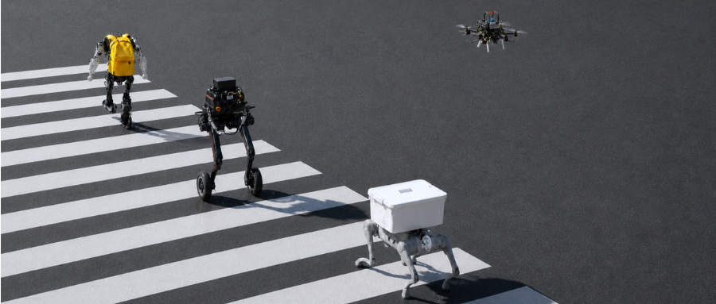

# Hi, I'm Xinyu Zeng 👋

### Robotics & Spatial Intelligence · Reliable Autonomy · Multi-Agent Coordination · Sociotechnical Systems

[中文](./README.md) | **English**

## About Me

> **From Engineering Practice to Systems Thinking**
>
> Coming from communications engineering, I have been developing autonomous systems for unmanned systems and robots, covering autonomous navigation, embedded systems, and middleware in GPS-denied, weak-network, and dynamic environments.
>
> As my practice extended from low-level state estimation and system implementation to the interaction between spatial state and upstream agents, my focus shifted from individual algorithms to the organizational mechanisms of intelligent systems: **how to understand and manage spatial state, organize intelligent behavior, and enable different agents to coordinate reliably under uncertainty.**

---

## Selected Engineering Work

Three representative work stages; commercial work, production work, and personal open-source rewrites are stated separately.

### Case A · Autonomous robot systems in constrained environments

- **Background**: UAV and multi-robot navigation in GPS-denied, weak-network, industrial-inspection environments.
- **Role**: Autonomous navigation R&D, state-machine task orchestration, multi-robot coordination, embedded deployment and integration.
- **Approach**: Built a GPS-denied UAV navigation task-execution middleware product on message-oriented middleware, on geometric SLAM and classical motion control; participated in military aircraft navigation module R&D.
- **Outcome**: Delivered across AGV, GPS-denied quadrotor, quadrupedal and bipedal platforms in weak-network, strong-interference, mixed indoor-outdoor environments.

**▶ Demo (click cover to play)**

| Military aircraft navigation module (sanitized simulator showcase) | GPS-denied UAV autonomous inspection in darkness |
| --- | --- |
|  |  |

### Case B · Legged robot autonomous navigation in dynamic environments

- **Background**: Long-duration, cross-floor goal navigation for quadrupedal robots in dynamic, unstructured environments.
- **Role**: Edge-cloud resource allocation, self-developed navigation middleware, scenario adaptation of key algorithms.
- **Approach**: Built edge-cloud navigation middleware, unifying localization state, task contracts, planning interfaces, and fault-recovery semantics.
- **Outcome**: Cross-floor loop passed cloud simulation 11/11; real-robot online mapping and planning running (see [quadruped-crossfloor-nav-ws](https://github.com/zxinyu-robot/quadruped-crossfloor-nav-ws)).

**▶ Demo**

| Edge-device map stitching | Online real-time voxel | Online real-time local point cloud |
| --- | --- | --- |
|  |  |  |

### Case C · Spatial state and intelligent system interaction

- **Background**: How robot spatial state can be reliably consumed by upstream agents and world models.
- **Role**: Engineering the three-space framework; designing world-state data distribution.
- **Approach**: Built a data-distribution middleware for the world-space state produced by legged robots, enabling asynchronous state-task navigation behavior interaction with upstream world models.
- **Outcome**: Publicly rewritten into buildable, testable cores — state contracts, localization recovery, terrain contracts, weak-network coordination, shared-memory fusion, read-only diagnostics.

**▶ Demo (spatial state interaction / data flow)**

| State-contract & task interaction sequence | Fork SpatialLink data flow |
| --- | --- |
|  |  |

<small>Click to enlarge: left — state-contract and task interaction sequence; right — Fork SpatialLink (FSLP) edge-to-edge spatial data flow.</small>

---

## Current Work

Unified direction: **autonomous intelligent systems in real environments and how they are organized**. Three progressive research scales, each backed by buildable, tested repositories (▶ marks a runnable demo).

### Shared foundation · spatial state and contracts

- **[ForkSpatial-Runtime-Engine](https://github.com/zxinyu-robot/ForkSpatial-Runtime-Engine)** — runtime for state contracts, execution leases, reason codes and on-device policy management. ▶ `runtime_demo`
- **[spatial-map-foundation](https://github.com/zxinyu-robot/spatial-map-foundation)** — hashed tile maps, geo-anchoring, versioned state transactions and semantic tiles. ▶ 3×3 Amap base-map demo

### 1 · Single-agent intelligence — spatial state, autonomous behavior, long-horizon execution and failure recovery

- **[quadruped-crossfloor-nav-ws](https://github.com/zxinyu-robot/quadruped-crossfloor-nav-ws)** — Go2 + Livox Mid-360 + Orin NX cross-floor goal navigation, real-robot loop.
- **[legged-navigation-runtime](https://github.com/zxinyu-robot/legged-navigation-runtime)** — failure recovery and diagnostics: localization-loss recovery state machine, terrain safe degradation, LiDAR-contamination self-rescue, SLAM/navigation diagnostics CLI. ▶ `recovery_demo` · `terrain_demo` · `slam-doctor diagnose`

### 2 · Collective intelligence — heterogeneous robots, multi-agent coordination, information sharing and task organization

- **[swarm-adapter-foundation](https://github.com/zxinyu-robot/swarm-adapter-foundation)** — multi-robot adapter infrastructure (C++17): unified state, map and directive contracts; weak-network QoS scheduling and versioned submap fusion; optional CycloneDDS transport; centralized federated learning (Flower) may only tune communication settings; the edge semantic gateway is the reference consumer. Measured with DDS + netem between two hosts (public internet link, not robots). ▶ `adapter_demo` · `swarm_link_probe`

### 3 · Sociotechnical systems — human–robot collaboration, authority allocation, risk governance and accountability

No dedicated repository yet; the mechanisms live in existing contracts: execution leases and on-robot veto (ForkSpatial, `DirectiveGate`), action whitelists with side-by-side comparison and automatic rollback (`SafetyEnvelope`, `PolicyGate`), reason codes and execution reports (`ReasonCode`, `ExecutionReport`), human-takeover learning (embodied-learning-baselines). Next: a text strategy library plus accountability-chain replay.

### Learning baselines

- **[embodied-learning-baselines](https://github.com/zxinyu-robot/embodied-learning-baselines)** — interruptible navigation learning (human takeover / DAgger), Go2 + Piper whole-body RL, cleaning-robot manipulation sim2real.

### Tools

- **[KMZ-editor](https://github.com/zxinyu-robot/KMZ-editor)** — DJI-standard KMZ route export and editing.

> The former swarm-spatial-link, multi-robot-map-fusion, edge-semantic-gateway, legged-terrain-state, SensorGuardNav-Runtime, SlamDoctor-Runtime, interactive-nav-learning, terrain-carry-rl and CleanRobot-Sim2Real-skill have been merged into the repositories above and archived. Repositories marked as sanitized rewrites are public re-implementations of past engineering work containing only independently testable cores; the code and tests are authoritative.

---

## How I Think About Systems

### Three-Space Law: how I understand the world a robot lives in

| Space | Question answered | Description |
| --- | --- | --- |
| Metric Space | Where am I? What is around me? Can I pass? | Localization, maps, geometric relations, motion state |
| Symbolic Space | What are the objects? What relations? What does the task mean? | Semantics, relations, constraints, task meaning |
| World Space | What state does the system believe the world is in? What is trusted, what can be executed? | Task-relevant state shared among the autonomous system, upstream agents, and world models |

The Three-Space Law is an evolving systems-thinking framework — not three mutually exclusive map algorithms, and World Space is not conflated with World Model.

### State Contracts: how I understand system reliability

State is more than a data structure:

- **Source & time** — where and when it was produced;
- **Frame & version** — which spatial reference and version it belongs to;
- **Confidence & validity** — whether it is trusted, whether it has expired;
- **Lifecycle** — how it updates, expires, and is revoked;
- **Authority & accountability** — who may use, modify, and act on it.

This extends to task contracts, behavior execution, fault recovery, and multi-agent coordination.

### Research scales: what I want to keep answering

Single-agent intelligence → multi-agent systems → sociotechnical systems (see Research Agenda).

---

## Research Agenda

These questions emerged gradually from engineering practice and are still evolving. I treat my current designs and learning mechanisms as hypotheses to be tested, not final answers.

### Layer 1 · Autonomous Systems

How to manage spatial state, task contracts, behavior execution, and fault recovery so that autonomous systems are verifiable and recoverable.

**01 — State Reliability**
> How should autonomous systems represent, validate and manage the lifecycle of spatial and decision-relevant states?

**02 — Experience and Adaptive Behavior**
> How can robots accumulate reusable behavioral experience without blindly reusing outdated or context-inappropriate policies?

*Verification paths*: stale-state detection, relocalization success rate, recovery time, safe stop, task completion rate.

### Layer 2 · Multi-Agent Coordination

How to achieve multi-agent coordination, task allocation, and risk control under heterogeneous capabilities, partial information, communication constraints, and dynamic environments.

**03 — Resilient Multi-Agent Coordination**
> How can heterogeneous agents coordinate and recover under partial observability, limited communication and conflicting constraints?

*Verification paths*: coordination under loss and latency, communication overhead, map consistency, task recovery.

### Layer 3 · Sociotechnical Systems

When autonomous agents enter public spaces, production systems, and urban infrastructure, how to design coordination rules, responsibility boundaries, and risk governance.

**04 — Authority and Accountability**
> How should task authority, human intervention, escalation rules and accountability be distributed among autonomous agents, operators and institutions in shared environments?

*Exploration paths*: human intervention rules, task authorization, escalation workflows, traceability of decisions and responsibilities.

### Research Approach

- **Systems engineering** — define contracts for state, task, authority, and failure recovery.
- **Computational experiments** — real robots, data replay, controlled fault injection, comparative evaluation.
- **Candidate mechanisms** — semantic state tokens, temporal / episodic memory, end-side continual adaptation, world models; each evaluated independently and replaceable.
- **Sociotechnical analysis** (planned) — combining STS, Technology Policy, and Computational Social Science.

---

## Fork · Engineering Philosophy

Fork is not a technology route competing with existing systems, but a set of **engineering values** formed through long-term practice.

- **Technology should serve real problems** — not technology for its own sake, not complexity as a measure of value.
- **Autonomy is not the absence of constraints** — intelligent systems should know their state, capability bounds, and behavioral authority.
- **Reliability comes from understandability and correctability** — explain state, recognize anomalies, recover, and allow rollback when needed.
- **Technological progress should respect human interests** — automation is not an excuse to evade responsibility; efficiency does not outrank safety.

> **佛科 · Fork — Technology should be reliable, and do no harm.**
>
> Fork means deriving capabilities from existing systems — through decomposition, composition, replacement, and evolution — to make technology interpretable, verifiable, and rollback-able.
>
> Engineering principles: **interpretable · verifiable · replaceable · rollback-able · reliable without harm**

**Fork Vision · Cross-embodiment urban autonomy**

> Quadruped, biped, wheeled, and aerial platforms navigating the same urban road autonomously. *Concept render, backed by the runnable evidence in Selected Engineering Work above.*

---

## Community & Collaboration

Fork is initiated and maintained by me personally. More than stars, I value people actually using, discussing, and contributing to my work.

**WeChat Official Account · 佛科思想录 (Fork Contemplations)**

- **Follow** — Scan the QR code above in WeChat, or tap Follow at the top of [this article](https://mp.weixin.qq.com/s/P-YrXc1eNrKBHbHvUd07pQ).
- **Ask & discuss** — Message the account directly after following: technical questions, architecture discussions, collaboration ideas. I reply to each one.

**Ways to participate:**

- Open **issues** on runtime design;
- Engage in **architecture discussions** on state contracts and failure-recovery mechanisms;
- **Port and adapt** to other robot platforms;
- Contribute **tests, reproducible experiments, and documentation improvements**;
- Collaborate on **heterogeneous robot coordination**.

**Long-term identity:**

> An independent builder and researcher working on reliable autonomy, spatial intelligence infrastructure, and the coordination of intelligent systems.

**My guiding question:**

*How can we build autonomous intelligent systems that are not only capable of acting, but also reliable in execution, accountable in operation, and compatible with the societies they serve?*
