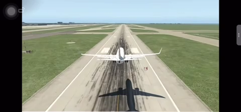
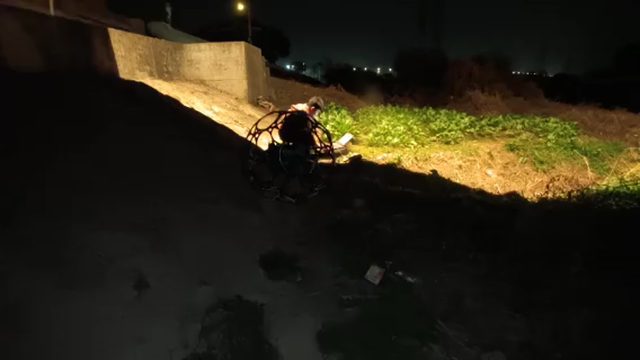
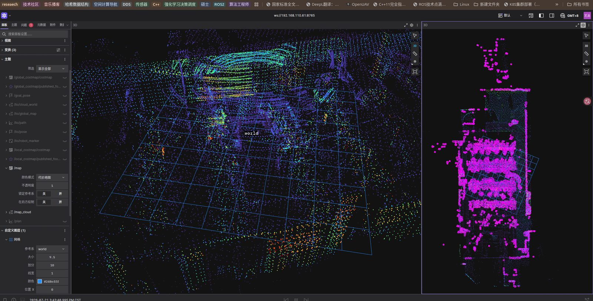
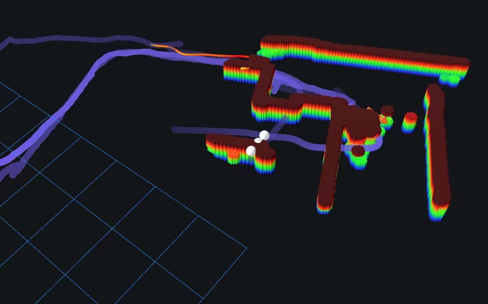
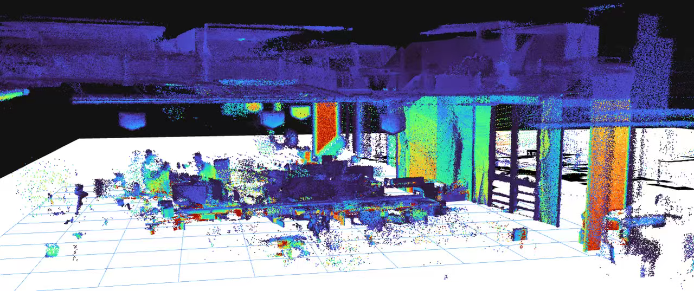
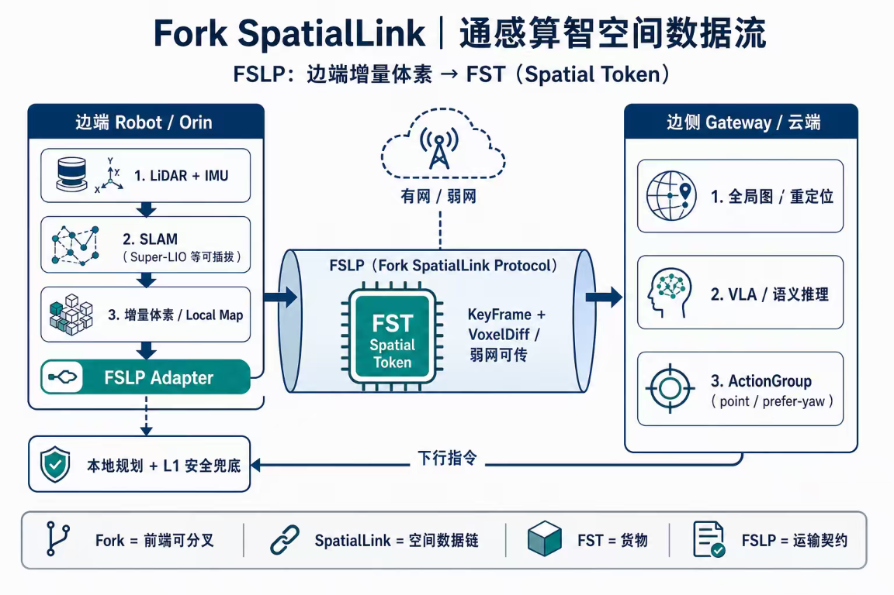

# Hi, I'm Xinyu Zeng 👋

### Robotics & Spatial Intelligence · Reliable Autonomy · Multi-Agent Coordination · Sociotechnical Systems

**中文** | [English](./README.en.md)

## About Me

> **From Engineering Practice to Systems Thinking**
>
> 从通信工程出发，我持续参与无人系统与机器人自主系统研发和项目产品交付，工程实践涵盖无 GPS、弱网、强干扰与室内外混合动态环境下的自主导航、嵌入式系统与中间件；过往涉及 AGV、无 GPS 四旋翼、四足及双足等不同形态平台。
>
> 随着实践从底层状态估计与系统实现，逐步延伸至空间状态和上层智能体的交互，我的关注点也从单一算法转向智能系统的组织机制：**如何理解和管理空间状态、组织智能行为，并推动不同主体在不确定环境中可靠协同。**

---

## Selected Engineering Work

三个代表性工作阶段；商业项目、实际工作与个人开源重构分开表述。

### 案例 A · 受限环境下的无人飞行器自主导航系统

- **背景**：无 GPS、弱网断网、工业巡检等受限环境中的无人机与多机导航。
- **职责**：自主导航系统研发、状态机任务调度、多机协同调度、嵌入式部署与系统集成优化。
- **实现**：基于几何3DSLAM与传统运动控制，并开发基于消息中间件的无 GPS 无人机导航任务执行中间件产品；以及参与军用飞行器导航模块研发。

**▶ 演示（点击封面播放）**

| 军工飞行器导航模块（脱敏模拟器展示） | 无 GPS 无人机黑暗环境简支桥梁自主巡检流程 |
| --- | --- |
|  |  |

### 案例 B · 动态环境下的足式机器人跨楼层长航时自主导航

- **背景**：动态非结构化环境中的四足机器人长航时、跨楼层目标导航。
- **职责**：端边协同资源分配、自研导航中间件、关键算法场景适配优化。
- **实现**：构建端边协同导航中间件，统一定位状态、任务契约、规划接口与故障恢复语义。
- **结果**：跨楼层闭环云端仿真 11/11 通过，真机在线建图与规划已运行（对应 [quadruped-crossfloor-nav-ws](https://github.com/zxinyu-robot/quadruped-crossfloor-nav-ws)）。

**▶ 演示**

| 端边协同地图拼接 | 在线实时体素 | 在线实时局部点云 |
| --- | --- | --- |
|  |  |  |

### 案例 C · 空间状态与智能系统交互

- **背景**：机器人的空间状态如何被上层智能体与世界模型可靠消费。
- **职责**：三空间认知框架的工程化、世界空间状态数据分发服务设计。
- **实现**：自研基于足式机器人世界空间状态的数据分发服务中间件，与上游世界模型进行异步状态任务导航行为交互。
- **结果**：公开重构为可构建、可测试的核心——状态契约、定位恢复、地形契约、弱网协同、共享内存融合、只读诊断。

**▶ 演示（空间状态交互 / 数据流）**

| 状态契约与任务交互时序 | Fork SpatialLink 空间数据流 |
| --- | --- |
|  |  |

<small>点击查看大图：左为状态契约与任务交互时序，右为 Fork SpatialLink（FSLP）边端—边侧空间数据流。</small>

---

## Current Work

统一方向：**真实环境中的自主智能系统及其组织机制**。

三个研究尺度（递进）：

1. **单体智能** — 空间状态理解、自主行为、长期任务执行与故障恢复；
2. **群体智能** — 异构机器人、多智能体协同、信息共享与任务组织；
3. **社会技术系统** — 人机协作、权限分配、风险治理与责任追踪。

近期工作：

**可靠自主导航**：四足跨楼层目标导航真机闭环已完成，已对齐定位状态、任务契约、规划接口与故障恢复语义。

- 四足跨楼层目标导航的真机闭环验证。[🔗 GitHub 仓库](https://github.com/zxinyu-robot/quadruped-crossfloor-nav-ws)
- 定位状态的度量底座——状态从哪来、落到哪个瓦片。[🔗 GitHub 仓库](https://github.com/zxinyu-robot/spatial-map-foundation)
- 任务契约与故障恢复语义的运行时载体。[🔗 GitHub 仓库](https://github.com/zxinyu-robot/ForkSpatial-Runtime-Engine)

**可复用空间运行时中间件**：让状态的来源、版本、置信度、有效期和失败语义被下游规划与执行模块明确理解。

- 管理状态的来源、版本与失效语义。[🔗 GitHub 仓库](https://github.com/zxinyu-robot/spatial-map-foundation)
- 让状态被下游规划与执行模块明确消费。[🔗 GitHub 仓库](https://github.com/zxinyu-robot/ForkSpatial-Runtime-Engine)

**弱网下的多机协同**：自适应通信与版本化子图融合，研究局部信息、通信延迟与数据不一致如何影响协同。

- 弱网下的自适应通信策略。[🔗 GitHub 仓库](https://github.com/zxinyu-robot/swarm-spatial-link)
- 版本化子图融合的数据路径。[🔗 GitHub 仓库](https://github.com/zxinyu-robot/multi-robot-map-fusion)
---

## Open Source Projects

> 按系统角色分层；均可构建、可测试，标注 ▶ 的附可运行 demo。核心载体定位见上方 Current Work。

### 核心工程载体

- **[spatial-map-foundation](https://github.com/zxinyu-robot/spatial-map-foundation)** ▶ 3×3 高德底图 demo
- **[ForkSpatial-Runtime-Engine](https://github.com/zxinyu-robot/ForkSpatial-Runtime-Engine)** ▶ `runtime_demo`

### 真实系统验证

- **[quadruped-crossfloor-nav-ws](https://github.com/zxinyu-robot/quadruped-crossfloor-nav-ws)** — Go2 + Livox Mid-360 + Orin NX 端侧真机闭环
- **[edge-semantic-gateway](https://github.com/zxinyu-robot/edge-semantic-gateway)** — 边侧语义调度网关。▶ `run_sim_bench.sh`（G0 协议闭环）

### 可复用能力

- **[legged-navigation-runtime](https://github.com/zxinyu-robot/legged-navigation-runtime)** — 定位失效恢复状态机。▶ `recovery_demo`
- **[SlamDoctor-Runtime](https://github.com/zxinyu-robot/SlamDoctor-Runtime)** — SLAM/导航诊断 CLI。▶ `slam-doctor diagnose`
- **[multi-robot-map-fusion](https://github.com/zxinyu-robot/multi-robot-map-fusion)** ▶ `fusion_demo`
- **[swarm-spatial-link](https://github.com/zxinyu-robot/swarm-spatial-link)** ▶ `weak_link_demo`
- **[legged-terrain-state](https://github.com/zxinyu-robot/legged-terrain-state)** — 地形状态契约与安全降级。▶ `terrain_demo`
- **[SensorGuardNav-Runtime](https://github.com/zxinyu-robot/SensorGuardNav-Runtime)** — LiDAR 污染定位自救。

### 学习基线

- **[interactive-nav-learning](https://github.com/zxinyu-robot/interactive-nav-learning)** — 可中断导航学习。
- **[terrain-carry-rl](https://github.com/zxinyu-robot/terrain-carry-rl)** — Go2 一体化 RL 脚手架。

> 标注"脱敏重构"的仓库为过往工程公开重写，只含可独立测试核心；实现状态以各仓库代码与测试为准。

## Fork · Engineering Philosophy

Fork 不是一套要与现有系统竞争的技术路线，而是我在长期工程实践中逐渐形成的**工程价值观**。

- **技术应当服务于真实问题** — 不为技术而技术，不以复杂度衡量价值。
- **自主不等于失去约束** — 智能系统应当知道自己的状态、能力边界与行为权限。
- **可靠性来自可理解与可纠正** — 能够解释状态、识别异常、恢复运行，并允许撤销与回滚。
- **技术进步应当尊重人的利益** — 自动化不成为逃避责任的理由，效率不凌驾于安全之上。

> **佛科 · Fork —— 科技应当可靠，而不加害。**
>
> Fork，意为从既有系统中派生能力，通过拆分、组合、替换与演进，让技术能力具备可解释、可验证、可回滚的特性。
>
> 工程主张：**可解释 · 可验证 · 可替换 · 可回滚 · 可靠而不加害**

**Fork愿景｜跨形态城市自主导航**

> 四足、双足、轮式与飞行平台在同一条城市道路上自主导航。*概念渲染图，对应上方 Selected Engineering Work 中的真实可运行证据。*

---

## How I Think About Systems

### 三空间法则：我如何理解机器人所处的世界

| 空间 | 回答的问题 | 描述 |
| --- | --- | --- |
| 度量空间 Metric | 我在哪里？周围有什么？可否通行？ | 定位、地图、几何关系、运动状态 |
| 符号空间 Symbolic | 对象是什么？什么关系？任务意味着什么？ | 语义、关系、约束、任务意义 |
| 世界空间 World | 系统所理解的世界处于什么状态？哪些可信、哪些可执行？ | 供自主系统、上层智能体与世界模型交互的任务相关状态 |

三空间法则是正在演进的系统认知框架，不等同于三种互斥的地图算法，也不把 World Space 与 World Model 混为一谈。

### 状态契约：我如何理解系统可靠性

状态不只是数据结构，还应包含：

- **来源与时间** — 从哪里产生、何时产生；
- **坐标系与版本** — 属于哪个空间基准与版本；
- **置信度与有效期** — 是否可信、是否过期；
- **生命周期** — 如何更新、失效与撤销；
- **权限与责任** — 谁可以使用、修改并依据它执行。

这一思想可继续延伸到任务契约、行为执行、故障恢复与多智能体协同。

### 研究尺度：我希望继续回答什么问题

自主智能体 → 多智能体系统 → 社会技术系统（详见 Research Agenda）。

---

## Research Agenda

这些问题从工程实践中逐步形成，仍在演进。我把当前的系统设计和学习机制视为待检验的假设，而非最终方案。

### Layer 1 · Autonomous Systems

如何管理空间状态、任务契约、行为执行与故障恢复，使自主系统具备可验证、可恢复的运行能力。

**01 — State Reliability**
> How should autonomous systems represent, validate and manage the lifecycle of spatial and decision-relevant states?
> 自主系统如何表达、验证与管理空间状态及决策相关信息的有效性、可信度和生命周期？

**02 — Experience and Adaptive Behavior**
> How can robots accumulate reusable behavioral experience without blindly reusing outdated or context-inappropriate policies?
> 机器人如何积累可复用的行为经验，同时避免过时经验或错误策略迁移到不适用的场景？

*验证路径*：状态过期检测、重定位成功率、恢复时间、安全停车、任务完成率。

### Layer 2 · Multi-Agent Coordination

如何在异构能力、局部信息、通信约束与动态环境下，实现多智能体协同、任务分配与风险控制。

**03 — Resilient Multi-Agent Coordination**
> How can heterogeneous agents coordinate and recover under partial observability, limited communication and conflicting constraints?
> 在局部可观测、通信受限及约束冲突的情况下，异构智能体如何保持协同并恢复正常运行？

*验证路径*：丢包与时延下的协同表现、通信开销、地图一致性、任务恢复能力。

### Layer 3 · Sociotechnical Systems

当自主智能体进入公共空间、生产系统与城市基础设施时，如何设计协作规则、责任边界与风险治理机制。

**04 — Authority and Accountability**
> How should task authority, human intervention, escalation rules and accountability be distributed among autonomous agents, operators and institutions in shared environments?
> 在自主智能体与人、组织共同运行的环境中，任务权限、人工介入、升级处置和责任追踪，应如何在智能体、操作人员与组织之间配置？

*探索路径*：人工介入规则、任务授权、故障升级流程、决策与责任的可追溯性。

### Research Approach

- **系统工程** — 定义状态、任务、权限与故障恢复的契约。
- **计算实验** — 真机、数据回放、可控故障注入与对照实验。
- **候选机制** — 语义状态 Token、时序/情景记忆、端侧持续适应、世界模型；各自独立评估、可替换，而非预设唯一路线。
- **社会技术分析**（计划中）— 结合 STS、Technology Policy 与 Computational Social Science，分析角色分工、运行规则、人工干预与责任机制。

---

## Community & Collaboration

佛科由我个人发起与维护。比起 Stars，我更看重有人真正使用、讨论、参与我的工作。

**欢迎通过以下方式参与：**

- 针对运行时设计提交 **Issue**；
- 对状态契约、故障恢复机制进行**架构讨论**；
- 其他机器人平台**接入适配**；
- 提交**测试、复现实验与文档改进**；
- 共同研究**异构机器人协同**。

**长期身份：**

> An independent builder and researcher working on reliable autonomy, spatial intelligence infrastructure, and the coordination of intelligent systems.

**My guiding question:**

*How can we build autonomous intelligent systems that are not only capable of acting, but also reliable in execution, accountable in operation, and compatible with the societies they serve?*

如何构建不仅能够自主行动，而且能够可靠执行、追溯责任，并与其所服务的社会相协调的智能系统？
