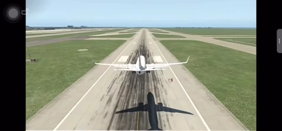
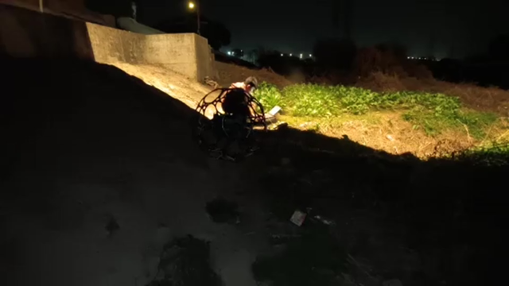
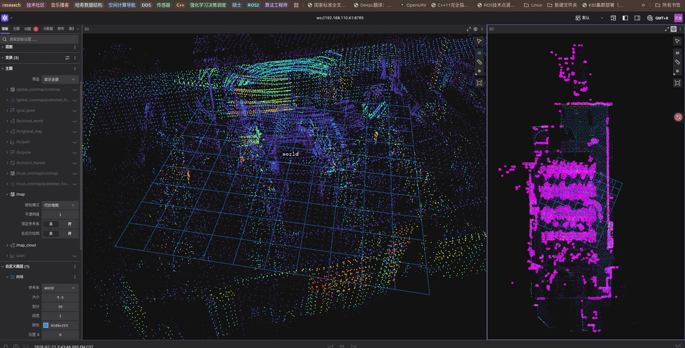
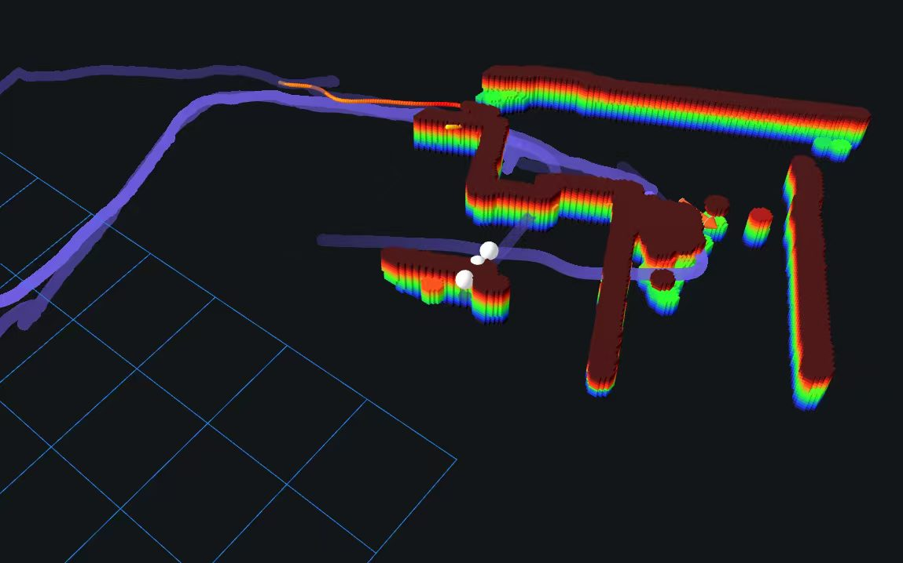
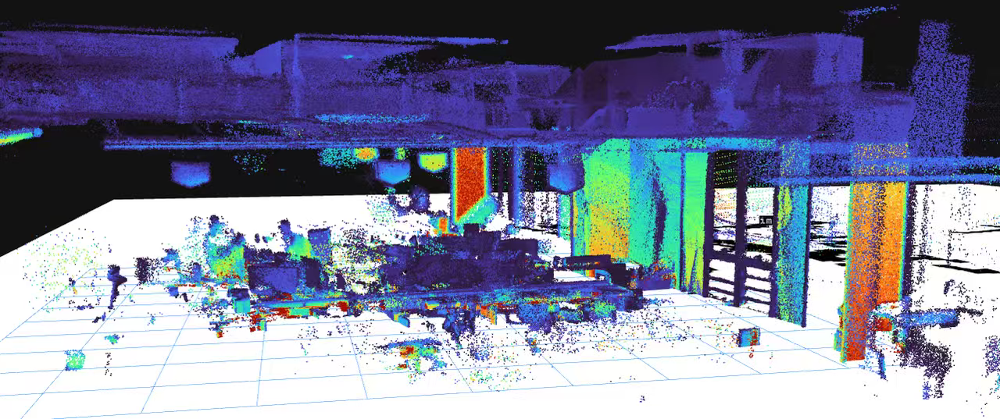
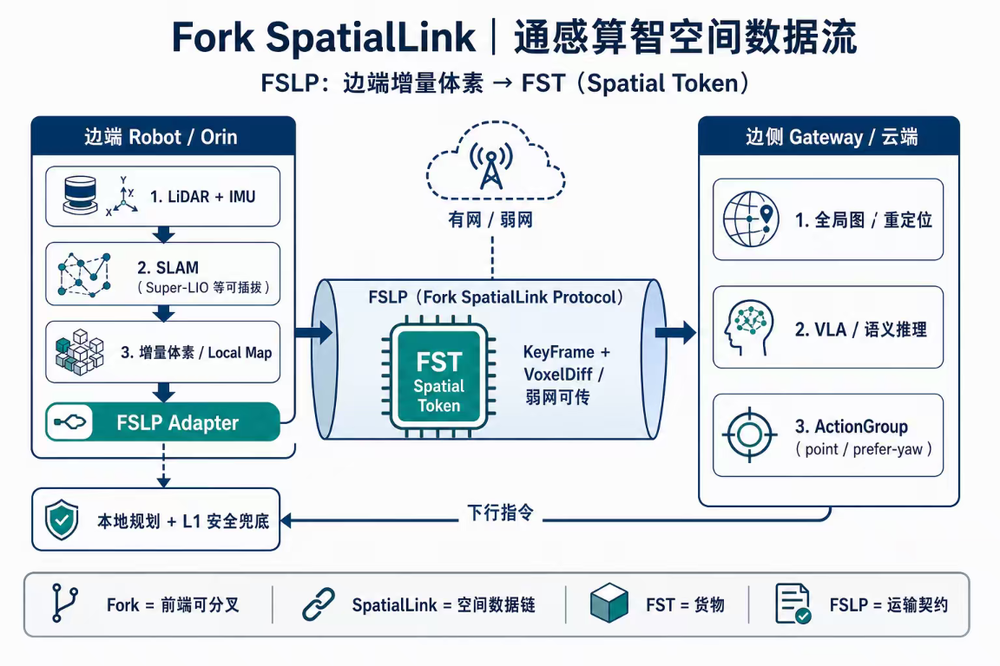

# Hi, I'm Xinyu Zeng 👋

### Robotics & Spatial Intelligence · Reliable Autonomy · Multi-Agent Coordination · Sociotechnical Systems

**中文** | [English](./README.en.md)

## About Me

> **From Engineering Practice to Systems Thinking**
>
> 从通信工程出发，我持续参与无人系统与机器人自主系统研发和项目产品交付，工程实践涵盖无 GPS、弱网、强干扰与室内外混合动态环境下的自主导航、嵌入式系统与中间件；过往涉及 AGV、无 GPS 四旋翼、四足及双足等不同形态平台。
>
> 随着实践从底层状态估计与系统实现，逐步延伸至空间状态和上层智能体的交互，我的关注点也从单一算法转向智能系统的组织机制：**如何理解和管理空间状态、组织智能行为，并推动不同主体在不确定环境中可靠协同。**

---

## Selected Engineering Work

三个代表性工作阶段；商业项目、实际工作与个人开源重构分开表述。

### 案例 A · 受限环境下的无人飞行器自主导航系统

- **背景**：无 GPS、弱网断网、工业巡检等受限环境中的无人机与多机导航。
- **职责**：自主导航系统研发、状态机任务调度、多机协同调度、嵌入式部署与系统集成优化。
- **实现**：基于几何3DSLAM与传统运动控制，并开发基于消息中间件的无 GPS 无人机导航任务执行中间件产品；以及参与军用飞行器导航模块研发。

**▶ 演示（点击封面播放）**

| 军工飞行器导航模块（脱敏模拟器展示） | 无 GPS 无人机黑暗环境简支桥梁自主巡检流程 |
| --- | --- |
|  |  |

### 案例 B · 动态环境下的足式机器人跨楼层长航时自主导航

- **背景**：动态非结构化环境中的四足机器人长航时、跨楼层目标导航。
- **职责**：端边协同资源分配、自研导航中间件、关键算法场景适配优化。
- **实现**：构建端边协同导航中间件，统一定位状态、任务契约、规划接口与故障恢复语义。
- **结果**：跨楼层闭环通过，真机在线建图与规划已运行（对应 [quadruped-crossfloor-nav-ws](https://github.com/zxinyu-robot/quadruped-crossfloor-nav-ws)）。

**▶ 演示**

| 端边协同地图拼接 | 在线实时体素 | 在线实时局部点云 |
| --- | --- | --- |
|  |  |  |

### 案例 C · 空间状态与智能系统交互

- **背景**：机器人的空间状态如何被上层智能体与世界模型可靠消费。
- **职责**：三空间认知框架的工程化、世界空间状态数据分发服务设计。
- **实现**：自研基于足式机器人世界空间状态的数据分发服务中间件，与上游世界模型进行异步状态任务导航行为交互。
- **结果**：公开重构为可构建、可测试的核心——状态契约、定位恢复、地形契约、弱网协同、共享内存融合、只读诊断。

**▶ 演示（空间状态交互 / 数据流）**

| 状态契约与任务交互时序 | Fork SpatialLink 空间数据流 |
| --- | --- |
|  |  |

<small>点击查看大图：左为状态契约与任务交互时序，右为 Fork SpatialLink（FSLP）边端—边侧空间数据流。</small>

---

## Current Work

统一方向：**真实环境中的自主智能系统及其组织机制**。

### 公共底座 · 空间状态与契约

- **[ForkSpatial-Runtime-Engine](https://github.com/zxinyu-robot/ForkSpatial-Runtime-Engine)** — 状态契约、执行租约与空间状态运行时。
- **[spatial-map-foundation](https://github.com/zxinyu-robot/spatial-map-foundation)** — 地图瓦片、空间锚定与版本化状态事务。

### 1 · 单体智能

- **[quadruped-crossfloor-nav-ws](https://github.com/zxinyu-robot/quadruped-crossfloor-nav-ws)** — Go2 四足机器人跨楼层导航真机闭环。
- **[legged-navigation-runtime](https://github.com/zxinyu-robot/legged-navigation-runtime)** — 足式导航运行时、故障恢复与诊断集成。
- **[SlamDoctor-Runtime](https://github.com/zxinyu-robot/SlamDoctor-Runtime)** — 面向机器人自主系统日志的离线诊断工具。

### 2 · 群体智能

- **[swarm-adapter-foundation](https://github.com/zxinyu-robot/swarm-adapter-foundation)** — 多机状态、地图与指令契约，以及弱网通信和子图融合。

### 3 · 社会技术系统

暂无独立仓库。相关机制分布在状态契约、故障恢复、人工接管学习和运行时执行语义中。

详细系统观、研究议程和工程原则见：

- [Systems Perspective](docs/systems-perspective.md)
- [Research Agenda](docs/research-agenda.md)
- [Engineering Philosophy](docs/engineering-philosophy.md)

---

## Public Collaboration

当前所有 `Current Work` 项目都开放不同层次的参与。

优先协作入口：

- **[SlamDoctor-Runtime](https://github.com/zxinyu-robot/SlamDoctor-Runtime)** — 离线诊断、ROS 2 / rosbag2 / MCAP 适配与故障案例。
- **[legged-navigation-runtime](https://github.com/zxinyu-robot/legged-navigation-runtime)** — 故障恢复、运行时诊断和导航系统集成。
- **[ForkSpatial-Runtime-Engine](https://github.com/zxinyu-robot/ForkSpatial-Runtime-Engine)** — 状态契约、执行语义和运行时接口。
- **[swarm-adapter-foundation](https://github.com/zxinyu-robot/swarm-adapter-foundation)** — 多机 Adapter、DDS、弱网 QoS 和子图融合。

没有真实机器人也可以参与：从离线日志、测试、文档和可复现案例开始。

**Discussion first. Implementation second. Validation throughout.**

---

## Open Source Projects

- **Runtime & Spatial State** — [ForkSpatial-Runtime-Engine](https://github.com/zxinyu-robot/ForkSpatial-Runtime-Engine) · [spatial-map-foundation](https://github.com/zxinyu-robot/spatial-map-foundation)
- **Navigation & Reliability** — [SlamDoctor-Runtime](https://github.com/zxinyu-robot/SlamDoctor-Runtime) · [legged-navigation-runtime](https://github.com/zxinyu-robot/legged-navigation-runtime) · [quadruped-crossfloor-nav-ws](https://github.com/zxinyu-robot/quadruped-crossfloor-nav-ws)
- **Multi-Robot Systems** — [swarm-adapter-foundation](https://github.com/zxinyu-robot/swarm-adapter-foundation)
- **Embodied Learning** — [embodied-learning-baselines-](https://github.com/zxinyu-robot/embodied-learning-baselines-)
- **Tools** — [KMZ-editor](https://github.com/zxinyu-robot/KMZ-editor)

历史项目已逐步并入上述主线或归档；当前实现状态以活跃仓库代码和测试为准。

---

## Systems Perspective

我关注能够被理解、验证、恢复和外部审查的自主系统。

- 状态应包含来源、时间、坐标系、版本、置信度、有效期和权限。
- 自主系统不仅要行动，也要知道何时不可信、如何降级和恢复。
- 工程结论应由真实问题、可复现证据和外部反馈支持。

深入阅读：

- [Systems Perspective](docs/systems-perspective.md)
- [Research Agenda](docs/research-agenda.md)
- [Engineering Philosophy](docs/engineering-philosophy.md)
- [Community & Collaboration](docs/community-and-collaboration.md)

---

## Contact

- [Hugging Face · RobotPelicans](https://huggingface.co/RobotPelicans)
- [微信公众号 · 佛科思想录](https://mp.weixin.qq.com/s/P-YrXc1eNrKBHbHvUd07pQ)
- 技术讨论、复现反馈和协作意向，欢迎通过相关仓库 Issue 或邮件联系。
